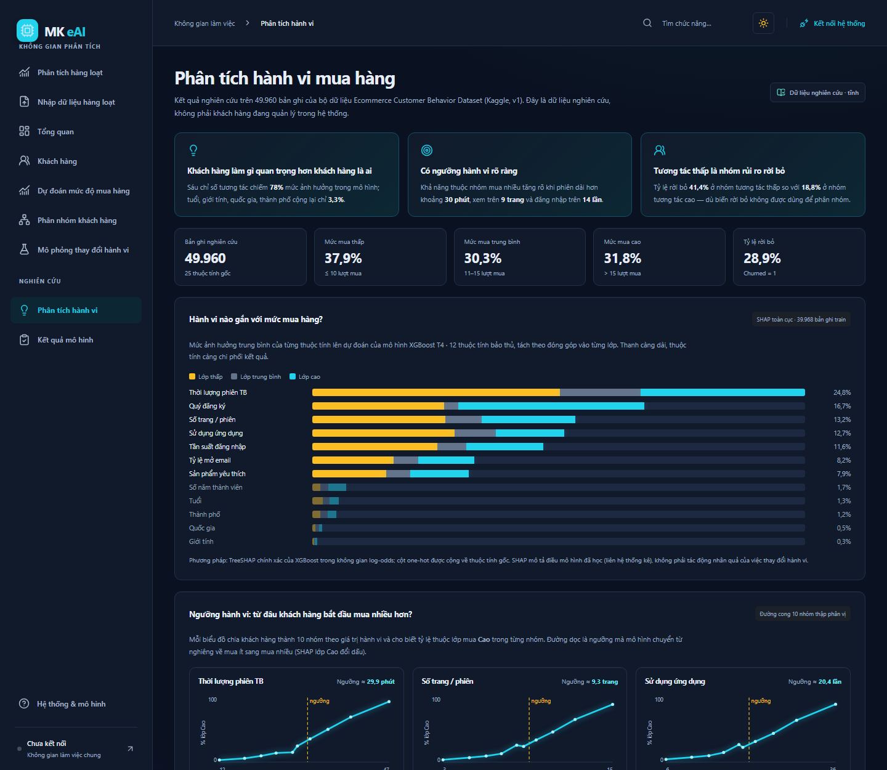
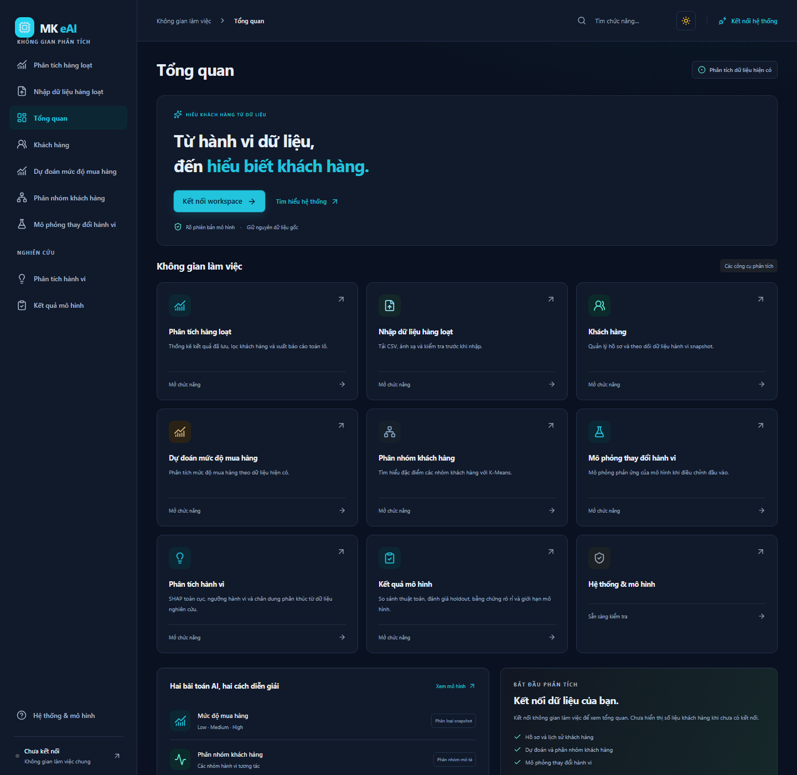

# MK eAI: phân tích và dự báo hành vi mua hàng của khách hàng thương mại điện tử

Sản phẩm của khóa luận tốt nghiệp *"Nghiên cứu ứng dụng AI trong phân tích và dự báo hành vi mua hàng của khách hàng
thương mại điện tử"*, sinh viên Trần Minh Kỳ (MSSV 1050080142, lớp 10_ĐH_CNPM2), giảng viên hướng dẫn
TS. Dương Thị Thúy Nga, Trường Đại học Tài nguyên và Môi trường TP.HCM.

MK eAI là ứng dụng web giúp người phân tích:

- dự đoán mức độ mua hàng (Thấp, Trung bình, Cao) của từng khách, kèm giải thích bằng SHAP;
- dự báo nguy cơ rời bỏ và lập danh sách khách hàng cần giữ chân;
- phân khúc khách hàng theo mức độ tương tác bằng K-Means;
- mô phỏng kết quả dự báo khi hành vi của khách thay đổi (What-if);
- nhập và phân tích hàng loạt khách hàng từ tệp CSV, xuất báo cáo PDF, Excel;
- hỏi đáp về dữ liệu với trợ lý AI (tùy chọn, dùng Gemini).

Các mô hình được huấn luyện trên bộ *Ecommerce Customer Behavior Dataset* (Kaggle, 50.000 bản ghi, 25 thuộc tính).



## Kết quả chính của các mô hình

| Mô hình | Kết quả trên tập kiểm tra 9.992 bản ghi (chấm một lần) |
|---|---|
| Dự đoán mức mua (XGBoost, 12 thuộc tính) | Macro F1 0,703 (khoảng tin cậy 95%: 0,694–0,712) |
| Dự báo rời bỏ (XGBoost, 21 thuộc tính) | ROC-AUC 0,886; 20% khách rủi ro cao nhất chứa 59% số khách rời bỏ |
| Phân khúc (K-Means, 3 nhóm) | Nhóm tương tác thấp có tỷ lệ rời bỏ 41,4%, gấp hơn hai lần nhóm tương tác cao |

## Cài đặt

Kho mã này đã có sẵn mô hình đã huấn luyện, dữ liệu và cơ sở dữ liệu mẫu, nên chỉ cần clone về rồi làm theo
**[hướng dẫn cài đặt](docs/HUONG_DAN_CAI_DAT.md)**. Tóm tắt:

```powershell
git clone https://github.com/TRANMINHKY708/BaoCaoDoAnTotNghiep.git MK-eAI
cd MK-eAI
python -m venv .venv
.\.venv\Scripts\python.exe -m pip install -r requirements.txt
cd frontend; npm ci; cd ..
```

Sau đó tạo cơ sở dữ liệu từ `database/MK-eAI-demo-database.sql`, khai báo `.env` và chạy hai cửa sổ backend, frontend
như trong hướng dẫn. Ứng dụng mở tại **http://127.0.0.1:5173**.

Tài khoản demo: `minhky` / `Admin@2026` (Admin), `operator1` / `Operator@2026` (Operator), `viewer1` / `Viewer@2026`
(Viewer).

## Công nghệ

| Phần | Công nghệ |
|---|---|
| Giao diện | React 19, TypeScript, Vite |
| Backend | Python 3.11, FastAPI, SQLAlchemy, Alembic |
| Cơ sở dữ liệu | PostgreSQL 17 |
| Mô hình | scikit-learn, XGBoost, SHAP (TreeSHAP của XGBoost) |
| Trợ lý AI | Google Gemini (tùy chọn) |

## Cấu trúc thư mục

| Thư mục | Nội dung |
|---|---|
| `backend/` | API FastAPI: xác thực, phân quyền, dịch vụ dự đoán, phân tích hàng loạt, báo cáo |
| `frontend/` | Giao diện React; mỗi chức năng một thư mục trong `src/features/` |
| `src/` | Các bộ xử lý dữ liệu dùng bên trong mô hình đã huấn luyện |
| `models/` | Mô hình đã huấn luyện (`*.joblib`) và metadata, khóa bằng mã băm SHA-256 |
| `alembic/` | Lược đồ cơ sở dữ liệu |
| `database/` | Cơ sở dữ liệu mẫu có sẵn khách hàng và tài khoản demo |
| `data/` | Dữ liệu nghiên cứu đã làm sạch, dùng cho trang phân tích dữ liệu nghiên cứu |
| `du-lieu-mau/` | Tệp CSV, JSON mẫu để thử chức năng nhập dữ liệu và dự đoán theo danh sách |
| `scripts/` | Lệnh chạy ứng dụng, khởi tạo cơ sở dữ liệu, kiểm tra cài đặt |


